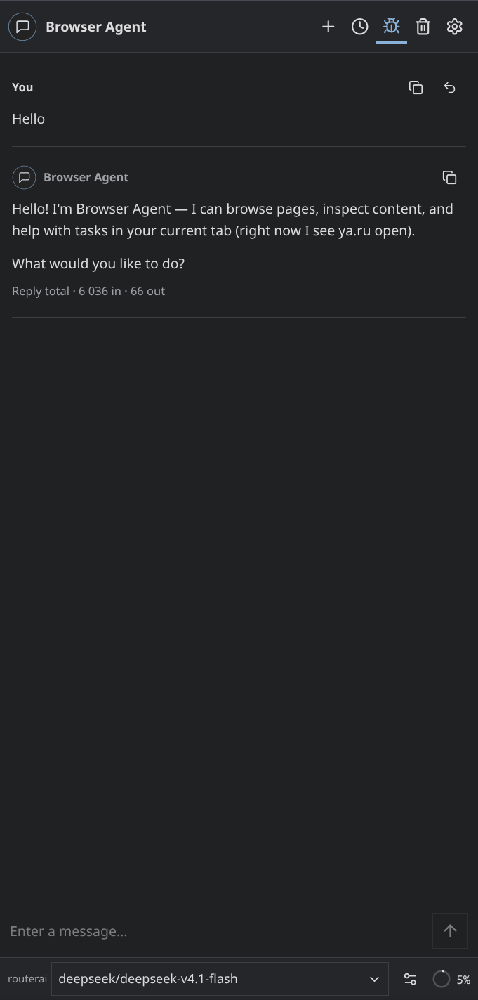
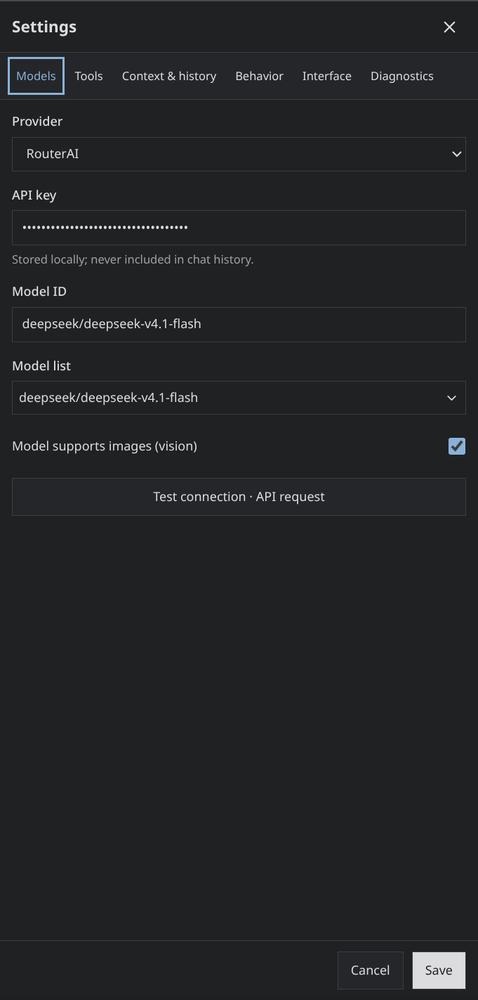

<div align="center">


# Browser Agent

**An AI assistant for Chromium browsers with bounded Chrome DevTools Protocol tools.**

[](https://developer.chrome.com/docs/extensions/)
[](https://www.typescriptlang.org/)
[](https://react.dev/)
[](LICENSE)
[](#localization)

[Русская версия (README_ru.md)](README_ru.md)

</div>

<div align="center">

<table>
  <tr>
    <td align="center"><b>Main</b><br></td>
    <td align="center"><b>Settings</b><br></td>
  </tr>
</table>

</div>

---

## Overview

**Browser Agent** is a side-panel AI assistant for Chrome, Chromium and Yandex Browser. It reads pages, clicks, types, switches tabs, inspects console and network through the DevTools Protocol, and searches the web. Tool output is bounded, large data is stored as artifacts, and your full chat history is never deleted by compaction.

---

## Features

- **Any provider** — RouterAI, AItunnel, OpenAI, DeepSeek, Google Gemini, Anthropic, or any OpenAI-compatible endpoint (OpenRouter, Groq, Ollama).
- **29 browser tools** — page reading, element actions, tabs, JavaScript, console, network, DOM/CSS, screenshots, performance, debugger, raw CDP. Each tool can be turned off.
- **Web search** — DuckDuckGo by default, Tavily optional. Public URLs can be read without opening a tab.
- **Bounded output** — every tool result fits a lean / balanced / full profile. Large payloads go to IndexedDB artifacts and are referenced by ID.
- **Context you control** — full transcript kept separately from what the model sees. `/compact` adds a summary card; visible messages stay.
- **Action summary** — all steps of one task collapse into a single expandable block inside the reply.
- **Floating page button** — round chat button on pages. Drag it onto the close target to hide it on that tab.
- **Adaptive UI** — works from 320 px wide panels up to desktop, light and dark themes, completion sound.
- **Two languages** — English and Русский, detected from the browser by default.

---

## Tech Stack

- **Platform:** Chromium Manifest V3 (side panel, `chrome.debugger`, service worker)
- **UI:** [React](https://react.dev/) + [Tailwind CSS](https://tailwindcss.com/)
- **Build:** [Vite](https://vitejs.dev/), TypeScript
- **Tests:** [Vitest](https://vitest.dev/) for units, [Playwright](https://playwright.dev/) for browser scenarios

---

## Installation

### From source

```bash
git clone https://github.com/Matvel007/browser-agent.git
cd browser-agent
npm ci
npm run build
```

Then open `chrome://extensions` (or `browser://extensions` in Yandex Browser), enable **Developer mode**, click **Load unpacked**, and select the `dist` folder.

> Requires Node.js 22.12+, 24 or 26+.

### Opening the panel

- Toolbar button
- `Alt+C` (change it in browser shortcut settings)
- Right-click context menu
- Floating button on the page

---

## Configuration

Open **Settings** in the panel:

- **Models** — choose a provider, paste the API key, select a model. *Test connection* sends one small request.
- **Tools** — enable or disable each tool, configure search.
- **Context** — set your model's real context window, output reserve and compaction threshold.
- **Behavior** — extra instructions, step limit, automatic CDP attachment.
- **Interface** — theme, language, floating button, sound.
- **Diagnostics** — capability checks, artifact storage, configuration export without keys.

API keys stay in local extension storage and are never written to chat history or exports.

---

## Known limits

- `chrome.debugger` exposes only the CDP domains Chromium allows for extensions.
- Console and network capture start when the debugger attaches.
- Opening the built-in DevTools can detach the extension's debugger.
- DuckDuckGo may block programmatic queries; a CAPTCHA is reported as an error.
- Yandex Browser 26.8 may block auto-loaded unpacked extensions — load `dist` manually.

---

## Development

```bash
npm run typecheck    # TypeScript
npm test             # unit tests
npm run icons        # regenerate PNG icons from logo.svg
npx playwright install chromium
npm run test:e2e     # browser tests against dist
```

Browser tests use a temporary profile and mocked model responses. No real API keys are required.

---

## Project structure

```text
src/services/     agent loop, context, providers, tools, CDP, storage, artifacts
src/background/   service worker: routing, targets, cancellation
src/content/      floating page widget
src/sidepanel/    React interface
tests/unit/       unit tests
tests/e2e/        browser scenarios
```

---

## License

Distributed under the **MIT License**. See [`LICENSE`](LICENSE) for details.
